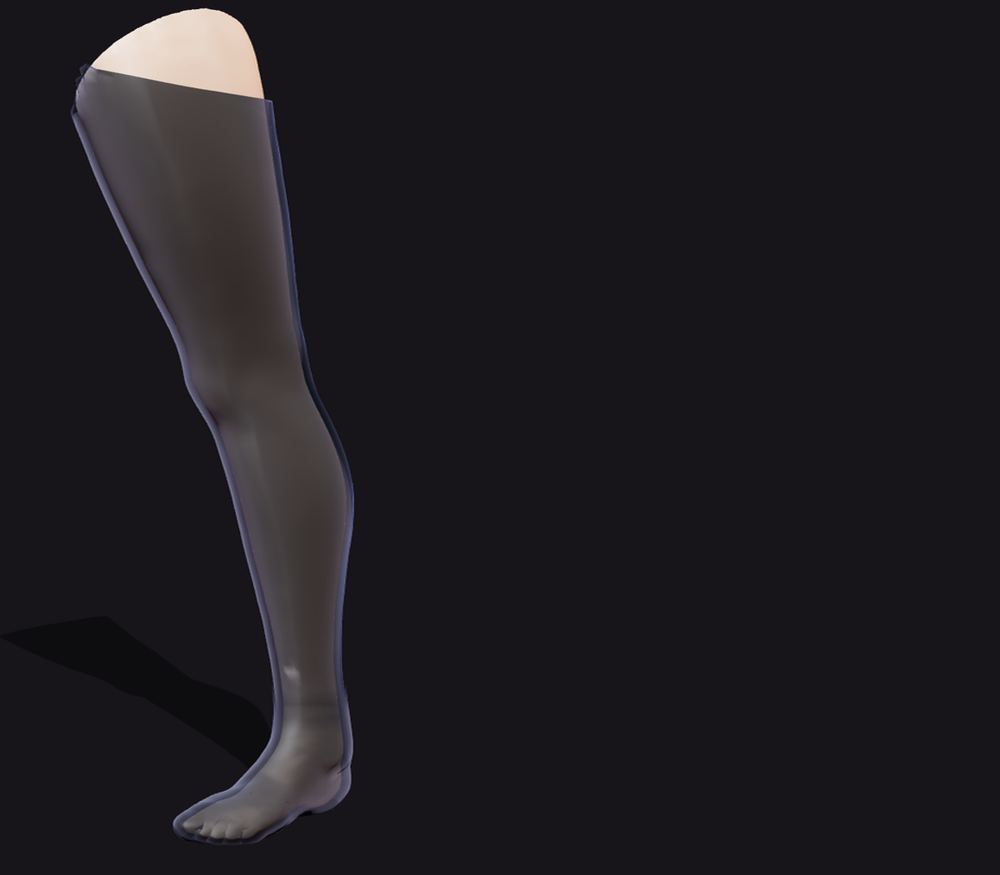
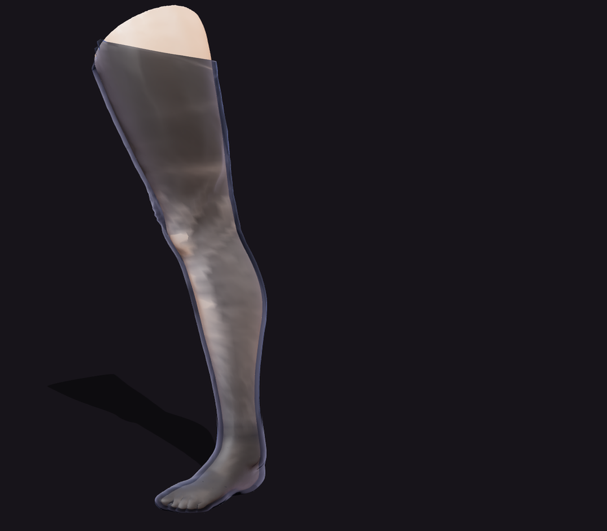
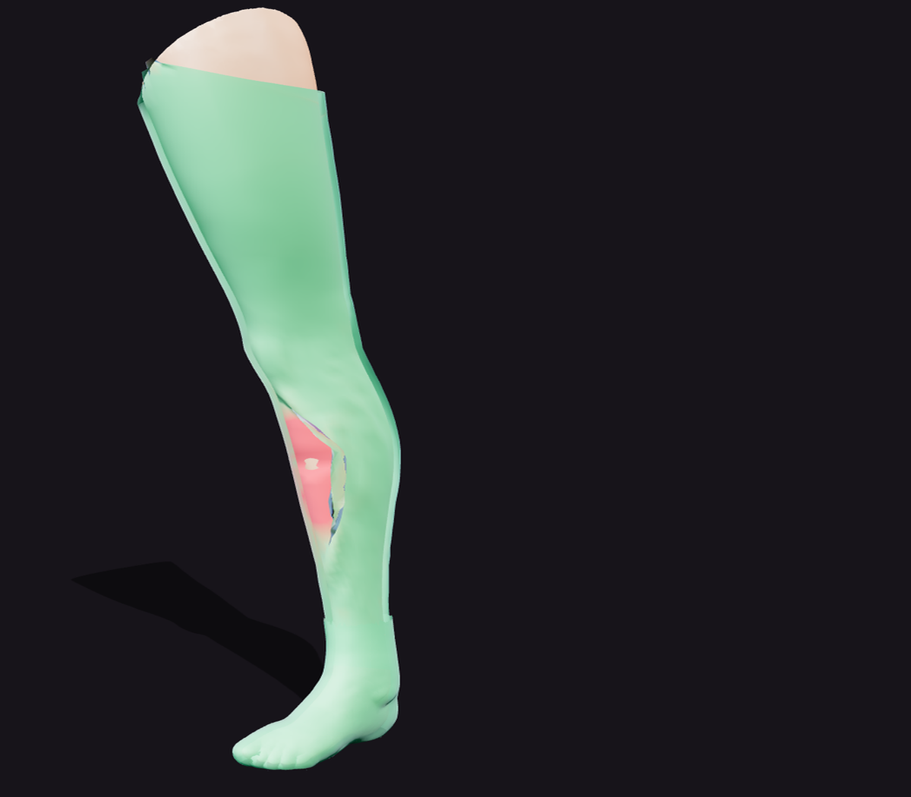

<div align="center">

# 丝袜张力模拟

**Stocking Tension Simulation · 纯浏览器的实时布料物理**

用鼠标捏住一条丝袜往外拉 —— 拉伸处会变薄、透光、透出皮肤，松手就弹回去。

<sub>Three.js · Verlet 布料解算 · BVH 网格碰撞 · 逐顶点张力着色器</sub>

[](https://threejs.org)
[](#)
[](#-本地运行)
[](LICENSE)
[](#-致谢)



<sub>🔗 在线体验：[stock.ruogg.cn](https://stock.ruogg.cn)</sub>

</div>

---

## ✨ 它到底做了什么

这不是预烘焙动画，也不是贴图假装的 —— 每一条丝袜的褶皱、每一次拉扯的回弹，都是浏览器里每秒 60 次现算出来的。

| | |
|---|---|
| 🧵 **3,300 个粒子的布料** | 绕腿包裹的 74 × 44 环形网格，13,068 条距离约束（环向 / 纵向 / 双向斜向剪切） |
| 👆 **捏住就能拉** | 射线拾取命中布料 → 抓住最近粒子 → 在相机平面上拖拽，形变实时扩散到周围 |
| 🫥 **拉伸即透光** | 逐顶点应变驱动透明度 / 粗糙度 / 冷色调高光，拉得越薄越透出皮肤，还带针织菱格纹 |
| 🧲 **不穿模** | 基于 BVH 的最近点查询 + **有符号距离**判定，怎么往腿里怼都不会穿过皮肤 |
| 🩹 **脚部贴合壳** | 脚趾、脚踝骨、脚跟全部保留细节，与布管在踝部交叉淡入淡出，看不出接缝 |
| 🎛 **可调参数** | 拉扯透明度、布料柔软度（约束迭代次数）、张力热力图调试视图、三档换姿势 |

<div align="center">
<table>
<tr>
<td width="50%"><br><sub><b>拉扯</b>：拉伸区域变薄透光</sub></td>
<td width="50%"><br><sub><b>张力热力图</b>：绿色松弛 / 红色高应变</sub></td>
</tr>
</table>
</div>

---

## 🎮 操作

| 操作 | 效果 |
|---|---|
| **拖拽丝袜** | 捏住并拉扯，拉伸处变透明、变亮 |
| **拖拽空白处** | 旋转视角 |
| **滚轮** | 缩放 |
| 左上角 `‹` | 收起控制面板（左侧留拉手可再展开） |
| 复位丝袜 | 布料回到初始贴合状态 |
| 换姿势 | 腿部整体旋转 90°，丝袜刚性跟随 |

---

## 🚀 本地运行

模型通过 `fetch` 加载，**必须走 HTTP**（直接双击打开会因 ES Module 跨域限制而白屏）。

```bash
git clone https://github.com/790395245/stocking-tension.git
cd stocking-tension

# 任意静态服务器都行，仓库里带了一个零依赖的
node server.js
# → http://localhost:8123
```

或者：

```bash
python3 -m http.server 8123
```

无需 `npm install`，无打包步骤 —— Three.js 通过 importmap 从 CDN 加载，整个项目就是 **一个 HTML 文件 + 一个 GLB**。

---

## 🔬 实现要点

真正难的不是"跑起来"，而是让它**贴在腿上且不发散**。下面几条都是踩过的坑。

### 1. 布料从模型表面反推，而不是摆一个圆柱

腿是弯曲的，截面不是圆。做法是：按高度把模型顶点切成 75 层 → 每层算**质心**作为环心，用平行传输构造该层的正交基 `(u, w)` → 顶点按方位角分 44 个桶，取每桶最远半径 → 圆向 + 层间各平滑两轮 → 沿半径生成环点 → `closestPointToPoint` 投影回表面再沿法线外推 10mm。

> ⚠️ 环心**必须**是截面质心。早期版本用"最接近质心的表面顶点"（medoid）当环心，结果朝向它自己的半径只有 ~1cm、对侧却 ~17cm，径向投影把粒子甩到完全错误的位置 —— 网格当场撕成碎片。

### 2. 碰撞要用**有符号**距离

这是穿模的真正原因。`closestPointToPoint` 给的是无符号距离：粒子一旦被拽进腿内部，它到表面的距离反而"变大"，碰撞逻辑就认为它没问题，于是永久卡在肉里（实测拖拽时最多 59 个粒子陷入、最深 4cm）。

```js
// 用面法线做有符号判定，内侧一律推出
const d = (p.x - cp.x) * n.x + (p.y - cp.y) * n.y + (p.z - cp.z) * n.z;
if (d < margin) { /* 推到 cp + n * margin */ }
```

同时把碰撞从"每帧一次 + 帧初缓存"改成**每个子步惰性查询**（位移超过 2.5mm 才重算，静止时几乎零开销），并让抓取目标点夹在表面外侧，手指往腿里怼也拽不穿布料。

### 3. Verlet 里摩擦项的符号很容易写反

衰减切向速度，Verlet 中 `v = pos - prev`，正确写法是 `prev += f * v_t`。写成 `-=` 等价于把切向速度**放大 1.85 倍** —— 前 0.5 秒一切正常，之后能量指数累积，2 秒后整体炸开。同理，穿透修正必须 `pos` 与 `prev` 同步移动（纯位置修正），否则每个子步都注入一次速度脉冲，膝窝这类凹陷区会来回振荡积累能量。

修完之后：静止 10 秒，平均应变 `0.002`、峰值 `~0.12`，完全收敛。

### 4. 张力着色器

通过 `onBeforeCompile` 注入 `MeshPhysicalMaterial`，不改 Three.js 源码。每帧把所有约束的拉伸量累加到顶点上得到 `aStrain`：

```glsl
// 拉伸 → 更透明、更冷的高光、更低粗糙度
diffuseColor.a  *= uBaseAlpha * mix(1.0, uStretchAlpha, stretchP);
roughnessFactor *= mix(1.0, 0.45, stretchP);
// 挤压 → 菱格针织纹更密更深
vec2 guv = vUv * vec2(72.0, 96.0);
```

### 5. 脚部单独处理：布管止于脚踝

脚是**水平**的。按高度切片会把脚跟（z = −0.11）和脚尖（z = +0.15）切进同一个 26cm 宽的截面，环半径取最大值后脚跟鼓成一团、脚趾乱切。

最终方案：**丝袜布管只做到脚踝**，脚部改用「腿部三角面沿顶点法线外扩 13mm 的贴合壳」。壳与皮肤严格平行，几何上不可能相交，脚趾缝和踝骨细节全保留；布管底部与壳顶边各带一段 `aFade` 交叉渐隐，踝部既无接缝也无双层深色带。

### 6. 性能

| 指标 | 数值 |
|---|---|
| 粒子 / 约束 | 3,300 / 13,068 |
| 每帧求解量 | 3 子步 × 5 次迭代 × 13,068 ≈ **196k** 次约束投影 |
| JS 物理耗时 | 静止 **2.7ms**/帧 · 拖拽 **4.7ms**/帧 |
| 模型 | 1,000,000 面 → `gltf-transform` weld + join + simplify → **120k 面 / 4.9MB** |

---

## 📦 目录结构

```
stocking-tension/
├── index.html          # 全部逻辑：渲染 / 布料 / 碰撞 / 着色器 / UI（单文件，~800 行）
├── assets/
│   └── female_leg_low.glb   # 精简后的腿部模型（120k 面）
├── docs/               # README 用图
├── server.js           # 零依赖静态服务器（带 GLB MIME）
├── smoke.js            # Playwright 冒烟测试：截图 + 控制台报错捕获
├── deploy.sh           # 一键构建 dist 并部署到 EdgeOne
└── LICENSE
```

---

## 🌐 部署

已部署在 **EdgeOne Makers**（腾讯云边缘加速）：

```bash
./deploy.sh            # 构建 dist/ 并上传，返回线上地址
```

`dist/` 只包含 `index.html` + 精简后的 GLB（共 4.8MB），原始 30MB 模型不上传。

---

## ⚠️ 已知限制

- 布料是**单层三角面**，没有自碰撞 —— 极端拉扯下布面可能自我折叠
- 腿部模型是静态网格，不做骨骼动画；"换姿势"只是整体刚性旋转
- 脚部为刚性贴合壳，不参与布料解算（这是刻意取舍：换取 100% 不穿模）

---

## 🙏 致谢

- **腿部模型**：[female LEG sculpt](https://sketchfab.com/) by **Pabler** — [CC BY 4.0](https://creativecommons.org/licenses/by/4.0/)，已用 `gltf-transform` 精简至 120k 面
- **渲染**：[Three.js](https://threejs.org) r160
- **碰撞加速**：[three-mesh-bvh](https://github.com/gkjohnson/three-mesh-bvh)
- 灵感来源：Unity 6 社区里病毒式传播的丝袜布料演示（RasenNeko / Sakura Rabbit）

## 📄 License

代码以 [MIT](LICENSE) 发布。**注意：`assets/female_leg_low.glb` 是 CC BY 4.0 素材，不适用 MIT** —— 再分发或商用请保留原作者署名 "female LEG sculpt" by Pabler。

---

<div align="center"><sub>如果这个项目让你觉得有意思，点个 ⭐ 吧</sub></div>
